<picture>
  <source media="(prefers-color-scheme: dark)" srcset="./assets/portada-dark.svg">
  
</picture>

<picture>
  <source media="(prefers-color-scheme: dark)" srcset="./assets/intro-dark.svg">
  
</picture>

<picture>
  <source media="(prefers-color-scheme: dark)" srcset="./assets/discografia-dark.svg">
  
</picture>

<picture>
  <source media="(prefers-color-scheme: dark)" srcset="./assets/tracklist-dark.svg">
  
</picture>

<a href="https://www.ci2.co/">
  <picture>
    <source media="(prefers-color-scheme: dark)" srcset="./assets/sello-dark.svg">
    
  </picture>
</a>

<picture>
  <source media="(prefers-color-scheme: dark)" srcset="https://raw.githubusercontent.com/sebassbb/sebassbb/output/serpiente-dark.svg">
  
</picture>

<picture>
  <source media="(prefers-color-scheme: dark)" srcset="./assets/creditos-dark.svg">
  
</picture>

### Redes

<a href="https://www.instagram.com/sebass_sb/">
  <picture>
    <source media="(prefers-color-scheme: dark)" srcset="./assets/red-instagram-dark.svg">
    
  </picture>
</a>
<a href="https://github.com/sebassbb">
  <picture>
    <source media="(prefers-color-scheme: dark)" srcset="./assets/red-github-dark.svg">
    
  </picture>
</a>

 

  <picture>
    <source media="(prefers-color-scheme: dark)" srcset="./assets/firma-dark.svg">
    
  </picture>

Arte generado con código propio en <code>scripts/</code> · estética inspirada en <i>Sauce Boyz 2</i> de Eladio Carrión (sin afiliación)
